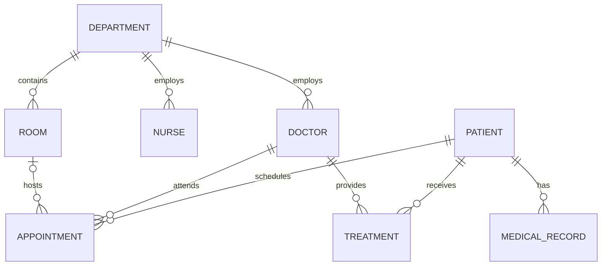

# Hospital Database Design

An entity-relationship model for organizing patients, staff, departments, appointments, treatments, rooms, and medical records.

**Author:** Jacob Butler  
**Project type:** Academic database design exercise  
**Status:** Design portfolio; the recovered assignment files contain ER diagrams, with no hospital SQL implementation located.

## Project overview

This design explores how a hospital's information can be separated into related entities. Patients connect to appointments, treatments, and medical records. Doctors and nurses belong to departments, while rooms can be assigned to appointments.

The project demonstrates entity identification, primary and foreign keys, one-to-many relationships, and translating operational activities into a relational model.

## Entity relationships

The readable diagram above follows the foreign-key fields in the saved model. Required parent relationships are working assumptions; room assignment is optional. Some connectors in the original drawing are incomplete. [Full diagram with attributes](docs/erd.md) · [Editable original diagram](docs/hospital-er-diagram.drawio)

## Entities

| Entity | What it models |
| --- | --- |
| PATIENT | Patient identity, contact details, blood type, and insurance reference |
| DOCTOR | Doctor identity, specialization, license, and department |
| NURSE | Nurse identity, license, department, and shift |
| DEPARTMENT | Hospital department, location, phone, and budget |
| APPOINTMENT | Patient/doctor meeting, scheduled time, reason, status, and optional room |
| TREATMENT | Patient treatment, responsible doctor, date, description, and cost |
| ROOM | Room number, type, floor, department, and availability flag |
| MEDICAL_RECORD | Dated diagnosis, allergies, and medications for a patient |

## Explore the project

Read this README and the full ER diagram directly on GitHub. To edit the original source, open `docs/hospital-er-diagram.drawio` in diagrams.net. No database installation or patient dataset is needed to review this design.

## Questions the model is intended to support

- Which appointments are scheduled for a particular patient or doctor?
- Which doctors, nurses, and rooms belong to each department?
- What treatments and medical-record entries belong to a patient?
- Which rooms are assigned to appointments?

These are proposed use cases. This repository does not claim to contain executed queries or a deployed hospital system.

## Design decisions and next steps

Separate entities prevent repeating staff and department details in every appointment. Foreign-key fields describe how records connect. Appointments and treatments are distinct because a scheduled visit and a performed treatment represent different events.

Before converting the design into SQL, the model needs explicit nullability, string lengths, uniqueness constraints, deletion rules, and scheduling-conflict rules. Allergy and medication lists should be separated into related tables for repeated values. The room availability flag alone cannot determine whether a room is free at a future appointment time.

[Detailed design notes](docs/design-notes.md)

## Portfolio preparation

The original editable ER diagram is preserved. The README and Mermaid diagrams were added during portfolio preparation. No real patient records, contacts, or insurance details are included. The original diagram's weak-entity styling is preserved in the source, but the independent RecordID in MEDICAL_RECORD means identifying dependency needs clarification before describing it as a weak entity.
