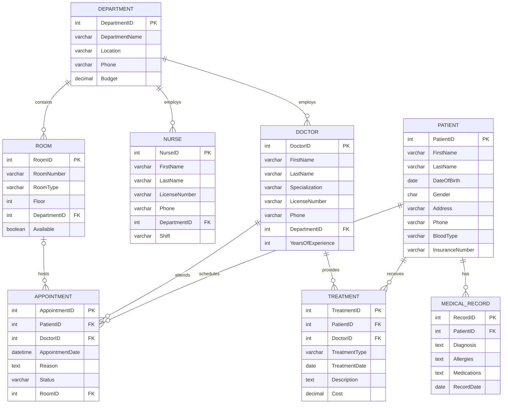

# Hospital database entity relationships

Reconstructed from the foreign-key fields in the original diagram. Mandatory relationships are working assumptions; an appointment may have no assigned room.

